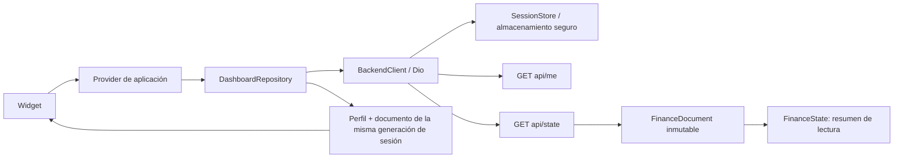
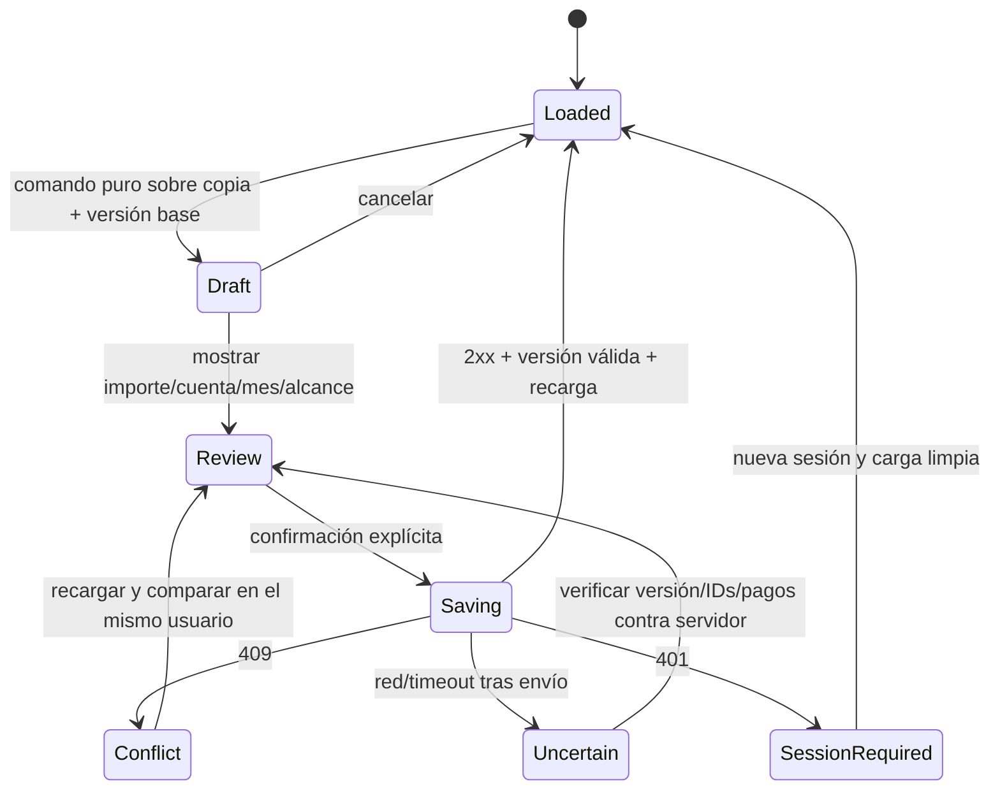

Estado actual 0.3.0: FinanceDraft conserva el documento completo; FinancialSave controla confirmación/concurrencia/resultado incierto; FinanceCommands aplica cambios puros; OperationForm y OperationScreen separan edición y confirmación. Ver [validación de etapa 2](PHASE2_VALIDATION.md). El cuerpo siguiente conserva el diseño inicial de Fase 0.

# Arquitectura — Fase 0

## Alcance real

Se mantienen Flutter, Riverpod, GoRouter, Dio y flutter_secure_storage. No hay cambio de backend, migraciones, repositorios financieros ficticios ni dependencias nuevas. La UI sigue teniendo acceso y resumen funcionales. La navegación completa y el motor financiero se desarrollan por fases, no mediante pantallas vacías.

## Estructura implementada

```text
lib/src/
  app.dart                              # GoRouter, composición y MaterialApp
  core/api/backend_client.dart          # HTTPS, cookie, errores y SessionStore
  core/models/
    user_profile.dart                   # Perfil validado y capacidad admin
    finance_state.dart                  # Proyección de lectura: cuentas/conteos
    finance_document.dart               # Snapshot JSON profundo inmutable + versión
  features/auth/login_screen.dart       # Presentación de acceso; no persiste password
  features/dashboard/
    dashboard_screen.dart               # Render y acciones de pantalla
    application/dashboard_controller.dart # Providers de aplicación
    data/dashboard_repository.dart      # Orquesta perfil → documento
    domain/dashboard_snapshot.dart      # Resultado consistente del dashboard
```

Las dos pantallas existentes conservan su ubicación para evitar movimientos innecesarios durante la corrección. Nuevas features usarán presentation/, application/, domain/, data/; en Fase 1 se puede normalizar la ubicación de las existentes junto al rediseño.

## Dependencias y ciclo de lectura



Los modelos no importan Material, Dio ni Riverpod. La presentación no lee mapas para calcular deudas ni contiene consultas HTTP. El repositorio solo orquesta lecturas y no decide permisos del servidor.

## Sesión y aislamiento implementados

- La cookie se guarda cifrada/Keychain, separada por API_BASE_URL. La contraseña no se persiste. HTTPS obligatorio, TLS normal, sin redirecciones y con timeouts.
- Login usa email normalizado y password intacto; una cookie antigua de dos segmentos se elimina. Cookie nueva: usuario, versión, vencimiento, HMAC. Verificación de firma/estado/revocación en servidor.
- Logout, nuevo login, vencimiento local o 401 cambian la generación de sesión. El repositorio verifica que esa generación no cambie entre el perfil y el documento; descarta respuestas tardías del contexto anterior. Un 401 de una petición antigua no borra la cookie de la sesión nueva.
- Providers autoDispose e invalidación al cerrar/entrar impiden reutilizar el snapshot anterior. Un 401 ofrece login sin presentar finanzas; red/500 permiten reintentar, no completar con datos de ejemplo.
- UserProfile.canManageUsers expresa visibilidad de presentación para admin validado; no concede acceso financiero ni evita un 403. La UI de Usuarios aún no existe.

## Documento completo y versión

FinanceState es un resumen parcial; no debe serializarse para guardar. FinanceDocument exige version entera positiva y conserva **todos** los campos JSON, incluidos desconocidos, con mapas/listas profundamente inmutables. La copia no comparte estructuras mutables con la respuesta original. No existe toJson ni método PUT en esta fase.

Esto previene dos pérdidas antes de habilitar escrituras: reconstruir estado solo con cuentas/gastos y omitir investments/resumeM/fundSeen, o guardar sobre una versión no validada. No es aún una implementación de sincronización de borradores.

## Contrato de sincronización futuro (no implementado)



Una cola por sesión, una operación en vuelo, botón protegido contra doble toque, IDs estables, draft aislado por usuario y generación. Nunca hacer rebase automático de un pago ni copiar la versión del servidor sobre un doc viejo. El estado incierto no anuncia éxito ni permite reaplicar el movimiento antes de reconciliarlo.

El backend no ofrece idempotency-key ni endpoint atómico de pagar cuota. Se trabaja con documento completo y control optimista; debe probarse el caso de commit con respuesta perdida. Ahorros usan la mezcla/permisos del servidor y una recarga posterior; no asumir versión global del fondo. Los PUT, perfiles mutables, invitaciones y backups se incorporan solo en su fase y después de revisión.

## Portado de reglas

El destino es domain/finance/ con funciones Dart puras: calendario y moneda; presupuesto/monthly; cuentas/pagos; deuda/cuotas; préstamos; ahorros/permisos; inversiones y desplazamientos. DTO conserva etiquetas/nombres JSON exactos, y los modelos de dominio tipan enums y fechas locales sin cambiar formato de API.

Antes de cada portado: fijar SHA del JS, generar casos sintéticos desde funciones puras sin acceder a APIs/DB, conservar entrada/salida y fuente; ejecutar la misma entrada en Dart. Comparación de dinero redondeado exacta; tolerancia solo para tasas intermedias justificada. Probar límites de mes, ceil/round, tasa cero, primera cuota anticipada, abonos, cuotas abiertas, resumeM, miembros ajenos, rendimiento por fila y datos incompletos.

No sustituir silenciosamente la aritmética JS por un nuevo esquema de centavos, anualidades vencidas o intereses de calendario. Si una regla parece inconsistente, documentar y pedir decisión de negocio antes de afectar datos. Actualmente solo el cálculo neto de cuentas está portado y probado.

## Persistencia, seguridad y límites

Solo sesión/preferencias no financieras en almacenamiento persistente; datos financieros en memoria por ahora. Offline editing/caché en disco y backups requieren diseño explícito de cifrado, borrado y protección de exportaciones; no son compromisos de Fase 0.

No usar logs de cuerpos, cookies, credenciales, respuestas financieras o tokens de invitación. Errores tipados presentan mensajes seguros y estados recuperables. No escribir migraciones/SQL ni incluir código/seed del repositorio web. No modificar garantías de permisos para lograr paridad de UI.

## Pruebas y evidencia

- Dominio/modelos: neto, documento inválido, versión, inmutabilidad y campos desconocidos.
- Datos: contrato de autenticación, cookie, expiración, HTTP 401/403/429/500, timeout, redirect/TLS-config.
- Aplicación: orden perfil/documento y cambio de sesión durante una petición.
- Widgets: login real, teclado pequeño, restauración, error recuperable, logout y cambio de cuenta.
- Las pruebas de escritura/versionado del servidor se inspeccionaron; no equivalen a un controlador móvil de escritura probado.
- CI compila Android debug e iOS simulador; hardware seguro, lectores de pantalla y firma requieren sus entornos y pruebas posteriores.
