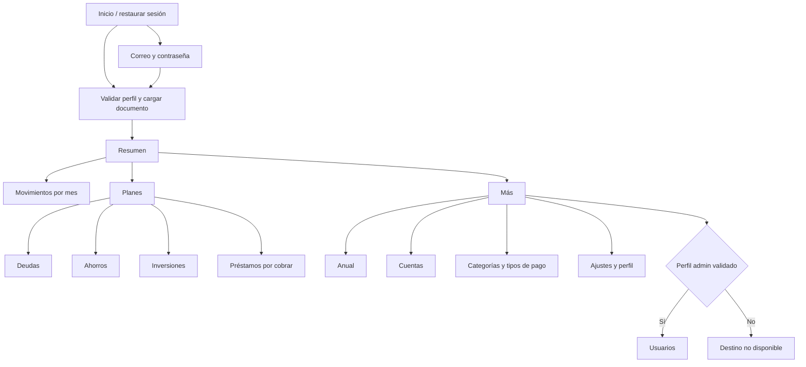

# Estrategia UX — Fase 0

Estado: propuesta de experiencia para revisar, no pantallas nuevas implementadas. Las reglas son las del [inventario](FUNCTIONAL_INVENTORY.md). No se investigó con usuarios externos ni se presentan hipótesis como resultados de investigación.

## Objetivos y decisiones

La persona debe distinguir «lo que tengo hoy», «lo que debo pagar este mes» y «lo que podría tener al cierre». No mezclar capital, cuotas y estimaciones. Jerarquía: cifra principal, período/estado, explicación breve y siguiente acción contextual.

- Barra inferior con **Resumen, Movimientos, Planes y Más**. Cuatro destinos dejan espacio para cifras y texto ampliado; botón contextual de registro en la pantalla, sin un quinto botón central ambiguo.
- Movimientos reúne la lista mensual de gastos, filtros y acceso al ingreso mensual; no representa un libro mayor que el backend no tiene. Cada fila conserva su tipo/origen (gasto, deuda, inversión, aporte o cobro) cuando existe.
- Planes es un selector de Deudas, Ahorros, Inversiones y Préstamos; evita cuatro pestañas permanentes. «Préstamos» siempre aclara «dinero que te deben».
- Más ofrece Anual, Cuentas, Categorías y tipos de pago, Ajustes y Usuarios (solo administrador validado). Reabrir una sección conserva el mes, pero cambiar cuenta reinicia el contexto.
- Tablet usa NavigationRail y panel detalle cuando hay ancho. En teléfono, pantallas completas para formularios y hoja de confirmación breve; no poner un formulario largo comprimido en un modal.
- No copiar campos editables con autoguardado al escribir. Preparar → revisar impacto → confirmar → guardar → respuesta verificada. Esto mejora UX y cumple la restricción financiera sin cambiar cálculos.

## Mapa propuesto (se implementa en Fase 1)

Rutas futuras: /resumen, /movimientos?mes=YYYY-MM, /planes, /planes/deudas/:id, /planes/ahorros/:id, /planes/inversiones/:id, /planes/prestamos/:id, /mas, /anual, /cuentas/:id, /categorias, /ajustes, /usuarios. Son rutas internas propuestas, **no endpoints de servidor**. Hoy solo existen /login y /dashboard funcionales; no se crean placeholders.

## Revisión por módulo (ocho preguntas obligatorias)

Cada módulo se revisa con: **objetivo; camino corto; información destacada; riesgos; interacción nativa; simplificación; vacío/red/operación; accesibilidad**.

### Resumen — Fase 1

1. Objetivo: decidir cómo va el mes y qué requiere atención.
2. Camino: abrir y elegir mes; alerta lleva al pago/plan correspondiente.
3. Destacar: cuentas hoy, compromisos pendientes, ingreso real/estimado, cierre proyectado, fecha de actualización.
4. Riesgo: confundir saldo real con proyección o sumar dos veces fondos en cuentas.
5. Nativo: tarjetas que abren detalle, pull-to-refresh, indicador de período visible.
6. Simplificar: mostrar tres indicadores antes del gráfico; explicación «qué incluye» accesible.
7. Vacío: comenzar por cuentas y salario; error recuperable sin sustituir por cero; loading skeleton sin montos simulados.
8. Accesibilidad: gráfico con tabla alternativa y etiquetas; no depender de verde/rojo.

### Movimientos, cuentas e ingresos — Fase 2

1. Objetivo: registrar lo que debe salir/entrar y saber de qué cuenta.
2. Camino: mes → agregar gasto o fila → pagar → revisión y confirmación.
3. Destacar: monto, estado, cuenta, mes y origen; detalle revela categoría/tipo de pago/serie.
4. Riesgo: pago doble, borrado con reversión, depósito USD que cambia saldo sin libro mayor, eliminación con enlaces.
5. Nativo: selector de mes, teclado monetario, buscador/filtros y selector de cuenta en formulario.
6. Simplificar: pendientes antes de pagados; retirar selectores de cuenta de todas las filas.
7. Vacío: CTA crear; sin red conserva snapshot solo en memoria y explica antigüedad; mientras guarda bloquea segunda confirmación.
8. Accesibilidad: importes sin truncar, nombres completos en detalle, foco al primer campo inválido.

### Categorías y tipos de pago — Fase 2

1. Objetivo: mantener opciones propias reutilizables.
2. Camino: Más → Categorías → agregar; conteo de uso antes de eliminar.
3. Destacar: nombre y número de gastos que la usan.
4. Riesgo: eliminar referencias; no inventar renombrado en cascada.
5. Nativo: listas separadas con encabezados, acción contextual con texto.
6. Simplificar: búsqueda local; validación de duplicado antes de confirmar.
7. Vacío: formulario de primera opción; red/guardado con el mismo protocolo del documento.
8. Accesibilidad: «Eliminar categoría X», foco estable tras error.

### Deudas — Fase 3

1. Objetivo: conocer saldo/cuotas y cuándo se termina.
2. Camino: Planes → Deudas → registrar → elegir modalidad → vista previa → confirmar.
3. Destacar: deuda total conocida, cuotas del mes, atrasos, fin del plan; cuota sin saldo tiene etiqueta propia.
4. Riesgo: interés mensual confundido con anual, sustitución sugerida equivocada, mover/recalcular pagados.
5. Nativo: selección inicial por tarjetas de modalidad; comparación antes/después al diferir cuotas.
6. Simplificar: solo campos relevantes; sustitución de gastos elegida explícitamente, no autoaceptada por nombre.
7. Vacío: primera deuda; plan inviable explica por qué; no aplicar cambios parciales si falla generación.
8. Accesibilidad: amortización en lista/tabla, tasas con unidad y plazos en texto.

### Préstamos — Fase 3

1. Objetivo: saber quién debe dinero y registrar cobros.
2. Camino: Planes → Préstamos → deudor → recibir → confirmar cuenta/fecha/valor.
3. Destacar: pendiente, fecha, vencido/próximo y cobros realizados.
4. Riesgo: cobro superior al saldo, reversión al borrar, creer que una fecha futura es dinero disponible hoy.
5. Nativo: filtros Vencidos/Próximos/Todos y fecha con calendario.
6. Simplificar: recibir propone pendiente pero no confirma automáticamente; nota secundaria.
7. Vacío: explicar que es dinero prestado a terceros; no notificaciones push ficticias; error mantiene formulario.
8. Accesibilidad: «Vence hoy/en X días» junto a fecha; indicador textual además del icono.

### Ahorros — Fase 4

1. Objetivo: seguir una meta y los aportes de cada integrante.
2. Camino: Planes → Ahorros → fondo → aporte propio → confirmar.
3. Destacar: saldo real, meta, cuota propia y estado de cada miembro.
4. Riesgo: tocar aportes ajenos, contar dos veces cuenta origen/destino, borrar fondo compartido sin revertir saldos.
5. Nativo: miembros en lista; permisos visibles por acción; enlace bancario opcional en sección avanzada.
6. Simplificar: mostrar «Tu aporte» y «Total del fondo» por separado, no dos cifras sin explicación.
7. Vacío: crear fondo; cambios de terceros exigen actualizar; participante de solo lectura no ve botones inaccesibles.
8. Accesibilidad: progreso con valor verbal, nombres sin cortar y mensaje de propiedad/permiso.

### Inversiones — Fase 4

1. Objetivo: programar aportes y comparar el plan esperado.
2. Camino: Planes → Inversiones → fijo/%/meta → vista previa → confirmar.
3. Destacar: aportado real, cuotas pendientes, ingreso base del %, rendimiento estimado separado.
4. Riesgo: tratar rentabilidad como garantizada o disponible; recalcular porcentuales pagadas.
5. Nativo: selector de modalidad y línea de tiempo con valores accesibles.
6. Simplificar: rendimiento opcional cerrado por defecto; tipo como etiqueta, sin falsa integración con broker.
7. Vacío: crear proyección; advertencia si el plan deja presupuesto negativo; sin guardar hasta revisión.
8. Accesibilidad: nominal y porcentual con unidades habladas; gráfico alternativo en tabla.

### Anual — Fase 5

1. Objetivo: comparar meses y planear el siguiente período.
2. Camino: Más → Anual → año/ventana → mes → detalle contextual.
3. Destacar: flujos reales frente a proyectados y saldos de cierre no sumables.
4. Riesgo: editar ingreso accidentalmente o confundir faltante con cero.
5. Nativo: teléfono usa resumen mensual vertical y tabla opcional desplazable; tablet conserva comparación ancha.
6. Simplificar: editar ingreso desde detalle, no al enfocar una celda.
7. Vacío: período sin movimientos; estimación marcada; borrador de ingreso se conserva ante red fallida.
8. Accesibilidad: encabezados de fila/columna, alternativa a gestos sobre gráfico y controles anterior/siguiente.

### Ajustes y perfil — Fase 5 (temas en Fase 1)

1. Objetivo: configurar supuestos y seguridad conscientemente.
2. Camino: Más → Ajustes → grupo Apariencia/Finanzas/Cuenta/Respaldos.
3. Destacar: correo activo, origen de tasa y cambios que afectarán proyecciones.
4. Riesgo: renovar contraseña sin sustituir cookie, exportar datos sensibles, restauración sin versión.
5. Nativo: selección de tema con muestras y hoja del sistema para exportar solo tras acción del usuario.
6. Simplificar: ninguna contraseña guardada; perfil y preferencias no mezclados con financiación.
7. Vacío/red: no sustituir tasa fallida por 0; error no pierde datos; restaurar datos reales no se habilita durante esta misión.
8. Accesibilidad: no depender solo del color de la muestra; foco en mensajes de error, campos seguros legibles.

### Usuarios — Fase 5

1. Objetivo: administrar accesos sin ver finanzas de otros.
2. Camino: Más → Usuarios (admin) → invitar/cambiar permiso → confirmar impacto.
3. Destacar: rol, activo, métodos de acceso, vigencia de invitación.
4. Riesgo: desactivar al último admin, filtrar un token o confundir admin con acceso a fondos ajenos.
5. Nativo: detalle por persona; enlaces temporales mostrados solo tras creación y compartidos explícitamente.
6. Simplificar: ocultar destino para usuario normal; servidor sigue siendo autoridad; no botón sin soporte.
7. Vacío: lista sin invitaciones; 403 recuperable; al perder permiso volver a un destino permitido.
8. Accesibilidad: rol escrito y acciones nombradas; confirmación de desactivación con nombre y efecto.

## Decisiones aplicadas y propuestas pendientes

Aplicado en Fase 0: errores recuperables, identificación por perfil, aislamiento de sesión y snapshot, versión validada sin autoguardado. Arquitectura separa presentación/aplicación/datos/dominio.

Aprobación requerida antes de alterar negocio: unificar KPI de Resumen con monthly.left, crear transferencias/libro mayor, interés por huecos reales de inversión, ajustes de criterio de tasas y cambio de regla al eliminar cuentas/fondos. No están implementados. Las decisiones de presentación anteriores no cambian reglas financieras.

## Criterios de calidad y skills

Se revisó el catálogo disponible. No hay skill dedicado a Flutter, UX research, accesibilidad móvil o pruebas Flutter. Se desempeñan esos roles mediante la revisión heurística documentada y tests del SDK. No se instalaron paquetes ni skills externos. Computer Use está disponible para observar el emulador; Visualize para diagramas interactivos, pero este mapa usa Mermaid versionado y no exige ese skill. No se usó Sites: es un proyecto Flutter existente.

Fase 6 debe validar con personas y dispositivos físicos, lectores TalkBack/VoiceOver y escala de texto ampliada. Los criterios escritos no equivalen a una certificación de accesibilidad ni a investigación ya ejecutada.
